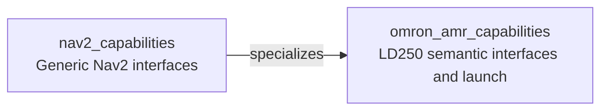

# Omron AMR Capabilities

Execution plans and capabilities for an Omron LD250 using `amr_core`, Nav2, capabilities2 and Fabric. The navigation provider starts `amr_ros/ld250.launch.py`, which brings up the hardware interface, robot description, Nav2 and online SLAM. RViz is disabled in the provider.

## Setup

Use the [Jazzy](.devcontainer/jazzy/devcontainer.json) or [Humble](.devcontainer/humble/devcontainer.json) devcontainer, or follow [direct setup](docs/direct_setup.md). Copy the corresponding `.env.example` to `.env` before opening the container, and configure the ROS domain and credentials for the prompt provider as needed. The container uses host networking; make sure it can reach the robot and that ROS nodes use compatible middleware and domain settings.

Build and source the workspace, and run commands from its root: the capability server searches `install/` relative to the current directory.

```bash
cd ~/colcon_ws
colcon build --symlink-install
source install/setup.bash
```

Configure the robot connection and hardware parameters in `amr_ros/config/ld250_parameters.yaml` before building. See the [Omron AMR repository](https://github.com/CollaborativeRoboticsLab/omron_amr) for hardware setup and Nav2 details. The provider uses the launch defaults; to change SLAM or hardware parameters, edit [AMRNav2LaunchRunner.yaml](providers/AMRNav2LaunchRunner.yaml) and rebuild. Avoid running another `amr_core` or Nav2 instance for the same robot.

## Capability inheritance



## Running Plans

The examples contain illustrative map-frame coordinates, not verified routes for your environment. Before running any plan, configure the robot and Nav2 for the actual site, verify localization, laser scans and both costmaps, and check every waypoint and recovery path. Ensure exclusive control and supervise the robot with an accessible stop. Navigation does not automatically undock the robot; see the AMR documentation for the separate supervised undocking procedure.

```bash
cd ~/colcon_ws
source install/setup.bash
ros2 launch omron_amr_capabilities system.launch.py filename:=amr_1.xml
```

The waypoint and pose providers start the LD250 launch on demand and wait for Nav2 lifecycle nodes and the `navigate_to_pose` action. The default configuration uses wall-clock time and monitors `/amr/battery_state`; update [fabric_config.yaml](config/fabric_config.yaml) for a different robot namespace or clock. To use different settings, pass `fabric_config:=/absolute/path/to/fabric.yaml` or `capabilities_config:=/absolute/path/to/capabilities.yaml`. The bond topic must match in both configuration files.

| Plan | Description |
| --- | --- |
| [amr_1.xml](plans/amr_1.xml) | Navigate to one waypoint. |
| [amr_2.xml](plans/amr_2.xml) | Navigate through five waypoints. |
| [amr_3.xml](plans/amr_3.xml) | Navigate through waypoints with a recovery branch. |
| [amr_4.xml](plans/amr_4.xml) | Navigate through waypoints with multiple recovery branches. |
| [amr_5.xml](plans/amr_5.xml) | Generate a plan for one waypoint. |
| [amr_6.xml](plans/amr_6.xml) | Generate a plan for a waypoint sequence. |
| [amr_7.xml](plans/amr_7.xml) | Generate a plan with a fallback waypoint. |

Plans 5-7 require a configured prompt service and model credentials. The generation runner automatically queues generated plans without a review pause. Do not run these examples on a physical robot unless an independent review and approval process prevents unreviewed motion. Set `start_prompt_tools:=false` when prompt services are not needed.# omron_amr_capabilities
